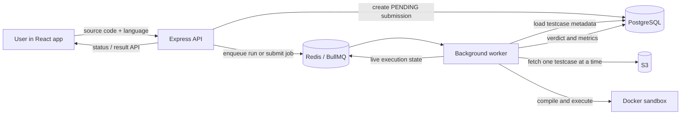

# The Engineering Problem Solved by CodeSM

## Executive summary

CodeSM solves the hard systems problem behind an online coding platform: **how to execute arbitrary, potentially hostile user programs without making the web application unsafe, slow, unreliable, or prohibitively expensive to operate.**

At first glance, a coding platform appears to be a CRUD application with an editor. The difficult part is not saving a problem or accepting a button click. It is taking a program supplied by an untrusted user, compiling it in one of several languages, evaluating it against private test cases, enforcing time and resource constraints, reporting a meaningful verdict, and doing all of that while many users may submit work at once.

This repository addresses that problem with a separate execution plane:

- The API persists a submission and responds quickly.
- Redis/BullMQ queues schedule the expensive work.
- Dedicated workers compile and run code outside the API process.
- Docker containers impose isolation and resource boundaries.
- PostgreSQL provides durable state and final results.
- S3 holds testcase assets, which workers fetch only when required.

The result is more than a programming-practice website. It is a small online judge architecture designed around security boundaries, back-pressure, durable state, and execution efficiency.

---

## 1. The real problem: executing code is not a normal web request

For a conventional web application, a request normally performs bounded work: validate input, read or write a database record, and return a response. Code execution breaks that assumption. A submission can:

- take a long time to compile or run;
- loop forever;
- consume excessive CPU, memory, process IDs, or output bandwidth;
- crash or corrupt the host process if it runs in-process;
- attempt to access the network, filesystem, or credentials;
- require private test cases that must not be exposed to the browser; and
- arrive in bursts during contests or at peak traffic.

Running this work directly in an Express request handler would create several failure modes. HTTP workers would stay occupied until compilation and grading ended, user-facing latency would rise sharply, a process crash could affect unrelated requests, and there would be no clean place to retry failed work or preserve a submission’s lifecycle. Loading all test data for every job would also produce memory and network spikes as the problem catalog grows.

The exact engineering challenge solved here is therefore:

> Build a secure, asynchronous, observable, and scalable pipeline that converts an untrusted source-code submission into a durable grading result.

---

## 2. The system-level solution

CodeSM splits the platform into independently responsible services rather than allowing the frontend or API to own execution.

This split is the important design decision. The API owns validation, authorization, persistence, and job creation; the worker owns expensive and risky execution; infrastructure services each have a focused role. The web API can remain responsive even while the worker is compiling or testing user code.

### Two execution modes, one lifecycle

The platform supports two user intents:

| Mode | User need | Testcases used |
| --- | --- | --- |
| `RUN` | Get fast feedback while developing | Sample/visible testcases only |
| `SUBMIT` | Receive a final judged result | All testcase records, including hidden cases |

Although they are scheduled through separate queues (`run-queue` and `submit-queue`), both modes create a persisted submission and follow the same state model: `PENDING` → `RUNNING` → terminal `COMPLETED` or `FAILED`. That consistency makes client-side polling, status recovery, dashboards, and debugging much simpler than maintaining unrelated “run” and “submit” implementations.

---

## 3. Submission lifecycle in detail

### Step 1: accept and persist the intent

When an authenticated user posts code to `POST /api/v1/submission/:problemId/:mode`, the backend validates the request and inserts a `submission` row with a `PENDING` status. The database record exists before the asynchronous job begins, so the platform has a durable identity for the user action even if the browser disconnects or a worker is delayed.

The submission record carries the problem, author, source code, language, mode, status, testcase counts, execution time, and memory fields. Final verdict detail is stored separately in `execution_result`. This separates lifecycle state from grading output and supports submission history and dashboard queries.

### Step 2: schedule rather than block

The backend pushes the work into BullMQ using Redis. `RUN` jobs use `run-queue`; `SUBMIT` jobs use `submit-queue`. Submit jobs are configured with two attempts and exponential backoff, while run jobs prioritize low-latency developer feedback.

This is the back-pressure mechanism. A sudden burst of submissions becomes queued work instead of a burst that exhausts API resources. More worker instances can consume the same queues, allowing execution capacity to scale independently of the HTTP layer.

### Step 3: expose progress safely

At worker pickup, the submission is updated to `RUNNING` in PostgreSQL and a current state is written to Redis. Status requests prefer the fresh Redis state but fall back to the database. The service also protects against a stale Redis “running” value overriding a terminal database state.

That detail matters operationally: a cache is used to improve responsiveness, but the database remains authoritative for durable terminal outcomes.

### Step 4: compile once and judge testcases

The worker writes the submitted source into a unique temporary directory and resolves a language specification. It supports C, C++, Java, Go, Python, and JavaScript. Compiled languages are compiled in the sandbox; interpreted languages skip compilation.

After compilation succeeds, the worker starts one restricted, long-lived Docker container for the submission. Each testcase is run using `docker exec` inside that same container. This avoids creating a fresh container per testcase, substantially reducing container startup overhead while preserving cleanup at the end of the submission.

For each testcase, the worker:

1. loads its S3 object using the testcase’s stored S3 key;
2. streams the input to the isolated process;
3. captures output, error information, duration, and process exit code;
4. normalizes output before comparison; and
5. stops early on a wrong answer, timeout, memory-related termination, or runtime error.

Early exit is an efficiency decision: after the first failing testcase, running the remainder cannot change the final “accepted” outcome.

### Step 5: persist an auditable result

The worker updates the submission with total, passed, and failed testcase counts, status, and timing data, then writes the verdict to `execution_result`. Compile failures retain compiler output for user feedback. The worker cleans up both the Docker container and the temporary host directory in `finally` blocks, including error paths.

If processing fails after configured retry attempts, the worker marks the submission as failed and copies job context into a dead-letter queue. This prevents permanently failed work from disappearing silently and creates a path for inspection or replay.

---

## 4. Security problem solved: hostile code must not control the platform

The central security boundary is that the API process never directly executes submitted code. Workers invoke a Docker-based sandbox with defense-in-depth controls defined in `workers/src/code/language.js` and `workers/src/code/docker.js`.

| Threat or failure mode | CodeSM mitigation |
| --- | --- |
| Infinite loop or very slow solution | `timeout` is applied to compile and execution commands; problem-level time limits replace the default run timeout. |
| CPU starvation | Docker CPU cap (default `0.5` CPU). |
| Excessive memory use | Docker memory and memory-swap limits (default `256m`). |
| Fork bombs/process exhaustion | Docker PID limit (default `64`). |
| Network exfiltration or external calls | Docker runs with `--network none`. |
| Privilege escalation | All Linux capabilities are dropped and `no-new-privileges` is enabled. |
| Modification of mounted code or host files | Runtime container mounts the submission directory read-only and runs with a read-only root filesystem. |
| Need for a writable working directory | A size-limited `/tmp` tmpfs is used instead of making the container filesystem writable. |
| Output flooding | Worker limits captured program output to 256 KiB by default. |
| Leaked execution environments | Container stop/removal and temporary-directory removal run during cleanup, including failed executions. |

The sandbox is intentionally not described as a complete substitute for production infrastructure hardening; Docker is one layer in a larger operational security model. However, this implementation moves execution from an unsafe in-process model to a constrained, disposable environment with concrete limits.

---

## 5. Scale and data-efficiency problem solved

### Why testcases need their own design

A naïve judge stores every testcase in a single large database document or downloads all testcases before execution. That choice is manageable for a small demo but becomes expensive under concurrent grading: many workers each allocate and transfer large, mostly unused testcase sets.

CodeSM separates testcase metadata from testcase content:

- PostgreSQL stores a lightweight row per testcase: problem ID, sequence order, sample/hidden flags, and S3 key.
- S3 stores the actual input/output data.
- The worker queries only relevant metadata—sample-only for `RUN`, all tests for `SUBMIT`.
- The worker retrieves an individual S3 object immediately before it runs that case.

This lazy-loading design bounds per-job testcase memory closer to the size of one testcase rather than the size of the entire problem’s dataset. It also enables an early wrong-answer exit without downloading remaining assets.

### Caching without making cache the source of truth

Workers cache positive testcase metadata in Redis for one hour. Empty queries are deliberately not retained, because an empty result might be temporary during migration or problem authoring. Submission status is also cached, with a database check that prevents stale cache state from masking a completed result.

These are mature cache semantics: Redis reduces repeated reads but does not replace PostgreSQL as the durable source of truth.

### Relational model and schema ownership

The project migrated its core model to PostgreSQL with Drizzle ORM and extracts shared schema definitions into a `db-schema` package used by both backend and workers. This prevents a common distributed-system failure: API and execution services silently drifting into incompatible assumptions about submission statuses, enum values, testcase fields, or database relationships.

The schema models authors, problems, tags, testcase metadata, submissions, and execution results as related entities. It supports queries such as a user’s problem history, accepted-problem counts by difficulty, and final verdict lookup without needing to reconstruct state from queue metadata.

---

## 6. Reliability problem solved

An asynchronous design only adds value if it also handles partial failure. CodeSM addresses several important failure cases:

| Failure | Expected behavior |
| --- | --- |
| Worker is busy or temporarily unavailable | The job stays in Redis until a worker consumes it. The submission remains visible as pending/running rather than losing the request. |
| Temporary worker failure during a submit job | BullMQ retries the job with exponential backoff. |
| Repeated execution failure | The submission is marked `FAILED` and job context is sent to `dead-letter-queue`. |
| Docker image missing in development | The worker can build the runner image automatically outside production, or report a clear failure. |
| S3 testcase cannot be obtained | Execution stops and returns a non-success result rather than producing a false acceptance. |
| Invalid language | The worker returns a compile-style failure and cleans temporary files. |
| Compile failure | Execution does not continue; compiler output is stored for feedback. |
| Redis state is stale | Terminal PostgreSQL status is preferred. |
| A user submits too frequently | A Redis token-bucket limiter enforces 10 authenticated requests per 60 seconds by default. |

The broader outcome is that a transient infrastructure fault does not have to become an ambiguous user experience. Each submission has a record, a state, and a terminal path.

---

## 7. Problem authoring is treated as a data-integrity workflow

The project also solves a related operational issue: ensuring a published problem has a valid, usable evaluation dataset.

Creators receive pre-signed S3 upload URLs for testcase and editorial assets. The backend then creates normalized records for the problem, tags, editorial metadata, and testcase metadata in a transaction. Before finalizing a problem, it verifies that the expected testcase and editorial objects can actually be retrieved from storage and that the problem contains both sample and hidden cases.

This prevents a broken problem from becoming visible simply because its metadata was inserted successfully. The platform validates the dependency between database state and object storage before marking the problem as ready.

---

## 8. Engineering decisions and trade-offs

### Separate workers instead of API-side execution

**Benefit:** isolates high-latency and high-risk work; allows independently scalable worker capacity.

**Cost:** introduces distributed state, queue operations, worker deployment, monitoring, and eventual completion rather than immediate synchronous output.

### Persistent container per submission instead of per testcase

**Benefit:** compiles once and avoids repeated container startup cost across a testcase set.

**Cost:** requires careful reset of `/tmp` state between cases and reliable teardown. The worker explicitly clears prior artifacts and always stops the container.

### S3-backed, lazily fetched testcases instead of embedding all data in PostgreSQL

**Benefit:** keeps relational rows small, limits memory peaks, and supports larger private testcase assets.

**Cost:** grading depends on object-storage availability and adds per-testcase network calls. The platform mitigates this by validating assets before problem finalization and exiting early on failed cases.

### PostgreSQL as durable state, Redis as queue/cache

**Benefit:** combines strong, queryable historical records with fast scheduling and live-status reads.

**Cost:** state coordination is necessary. The status API explicitly resolves cache/database disagreement in favor of a terminal database result.

### Separate run and submit queues

**Benefit:** lets the product differentiate interactive feedback from final grading and apply different retry/priority behavior.

**Cost:** the worker must maintain a shared and correct state model across both paths.

---

## 9. The impact in practical terms

The project turns an unsafe, synchronous workflow into an execution platform with bounded resource use and recoverable outcomes.

For users, this means they can run code against examples, submit against hidden tests, receive compiler/runtime/verdict feedback, and see a reliable history of their work.

For platform operators, it means a burst of submissions creates queue depth rather than crashing the API; worker capacity can be increased without changing the frontend; testcases do not have to reside in application memory; and failed jobs remain diagnosable.

For problem creators, it means test data and editorial content are verified before a problem reaches users.

---

## 10. Resume / interview-ready articulation

### One-line version

> Engineered a secure, asynchronous online-judge pipeline that executes untrusted multi-language code in constrained Docker sandboxes, using PostgreSQL for durable submission state, Redis/BullMQ for scheduling, and S3 for lazy testcase retrieval.

### Short project explanation

> I solved the challenge of safely grading arbitrary user code without blocking the web API. I split the platform into an Express API and independent BullMQ workers: the API persists and queues submissions, while workers compile and run them in Docker with CPU, memory, process, network, filesystem, timeout, and output limits. I also separated testcase metadata from S3-backed content so workers load tests one at a time, which controls memory and avoids unnecessary downloads. Results are persisted in PostgreSQL, surfaced through Redis-backed status tracking, and failed jobs have retry and dead-letter handling.

### Strong interview framing

> The key insight was that “submit code” is a distributed-systems and security problem, not just an API endpoint. I had to make execution asynchronous, constrain untrusted workloads, preserve durable state across retries, avoid a single point of failure in the API, and keep testcase data scalable. The implementation reflects those concerns directly: queues for back-pressure, Docker for isolation, Postgres for source-of-truth results, Redis for scheduling and live status, and S3-backed lazy testcase loading.

---

## 11. Repository evidence

| Concern | Implementation location |
| --- | --- |
| Submission persistence, status fallback, result retrieval | `backend/src/api/submission/submission-service.ts` |
| Job creation, queue selection, retries, backoff, priorities | `backend/src/api/submission/submission-helper.ts` |
| Queue definitions | `backend/src/loaders/queue.ts` |
| Worker lifecycle and dead-letter handling | `workers/src/worker.js` |
| Execution orchestration and early exit | `workers/src/code/execute.js` |
| Docker lifecycle and per-test execution | `workers/src/code/docker.js` |
| Sandbox controls and language specifications | `workers/src/code/language.js` |
| Testcase metadata queries and result persistence | `workers/src/code/db-service.js` |
| Sandbox image toolchain | `workers/docker/sandbox-runner/Dockerfile` |
| Resource defaults | `workers/utils/constants.js` |
| Problem creation and storage verification | `backend/src/api/problem/problem-service.ts` |
| Shared relational schema | `db-schema/src/db/schema.ts` |
| Submission rate limiting | `backend/src/shared/ratelimiter.ts` |

## Accuracy note

This document describes the current implementation rather than only its intended architecture. In particular, the current enqueue payload contains source code and execution parameters in addition to `submissionId`; PostgreSQL remains the durable source of truth. Any later optimization to enqueue only a submission ID should be described as a future improvement unless the worker is changed to read the source and limits exclusively from the database.
